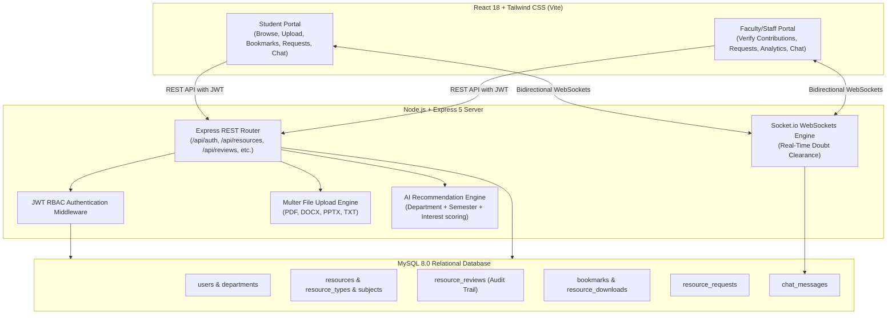

# egspec.com • Academic Resource Hub

A centralized, secure, role-based academic document repository, AI Doubt Solver, and collaboration platform built for **E.G.S. Pillay Engineering College (`egspec.com`)**. The platform enables students and faculty to share, verify, discover, and download academic study materials while incorporating **AI Academic Clarity & Doubt Tools**, **Automated Doubt Clarity Chat Replier**, and **Real-Time Doubt Clearance WebSockets**.

---

## 1. System Architecture



---

## 2. Key Features

### 1. Role-Based Access Control (RBAC)
- **Students**: Upload study materials (subject to verification), search published resources, download files, bookmark materials, submit requests for missing materials, and chat directly with staff for doubt clearance.
- **Staff / Faculty**: Review and verify pending student uploads (Approve/Reject with remarks), manage academic taxonomies (departments, subjects, types), fulfill student requests, view download analytics, and answer student doubts in real-time.
- **Admin**: Overall administrative control over users, departments, and course metadata.

### 2. Multi-Stage Contribution & Verification Workflow
- When a student contributes a resource, it is assigned **`PENDING`** status and is automatically shielded from public search results.
- Faculty members review the document in the **Verify Contributions** board.
- Upon approval, the status transitions to **`PUBLISHED`**, making it instantly searchable, downloadable, and bookmarkable across the campus.

### 3. AI Academic Clarity & Doubt Tools Suite (`/ai-tools`)
- **Concept & Doubt Solver**: Select syllabus subject, choose explanation depth (*Simple*, *13-Mark University Model*, or *Deep Technical*), and receive structured theoretical breakdowns, real-world examples, and verified notes recommendations.
- **Code & SQL Query Debugger**: Submit code or database queries (SQL, Python, Java, C++, JS) to diagnose errors, optimize execution plans, and obtain time/space complexity analysis.
- **Exam Question & Scoring Rubric Builder**: Generates university-style 2-mark and 13-mark questions paired with official evaluator mark distribution rubrics.
- **High-Yield Revision Cheat Sheets**: Creates 30-second bullet summaries, key formulas, and common pitfalls to avoid before exams.

### 4. Global Floating AI Doubt Assistant
- Accessible on **every page** across the platform via floating trigger button.
- Instant drawer dialog with quick syllabus chips (ACID, BCNF, AVL Trees, Dijkstra, Deadlock) and direct links to study notes.

### 5. Automated Doubt Clarity Reply Engine
- Integrated directly into the **Doubt Clearance WebSocket Chat**.
- Automatically detects student conceptual questions and immediately posts a structured syllabus breakdown and relevant lecture notes link while faculty are notified.

### 6. Cross-Device & Mobile Access (`egspec.com`)
- Configured with `0.0.0.0` host binding and dynamic hostname resolution.
- Can be opened from any smartphone, tablet, or laptop on the college Wi-Fi via `http://<LAN_IP>:3000` (`http://10.146.24.230:3000`) or locally via `http://egspec.com:3000`.

### 7. Real-Time Doubt Clearance Chat
- Socket.io powered instant messaging allows students to message faculty members directly.
- Supports typing indicators, read receipts, unread badges, and full database persistence for doubt resolution.

### 8. Multi-Facet Search & Discovery
- Full-text keyword search across titles and descriptions.
- Parametric filtering by **Department**, **Subject**, **Resource Type** (Lecture Notes, Question Papers, Lab Manuals, etc.), **Academic Year**, and **Semester**.

---

## 3. Technology Stack

| Layer | Technologies |
| :--- | :--- |
| **Frontend** | React 18, React Router v6, Tailwind CSS, Lucide Icons, Axios, Socket.io-client, Vite |
| **Backend** | Node.js, Express 5, Socket.io, Multer, JSON Web Tokens (JWT), Bcrypt |
| **Database** | MySQL 8.0 with InnoDB engine, prepared statements (`mysql2/promise`), foreign keys, and indexes |
| **Testing** | Node.js Automated Integration Suite, End-to-End Workflow verification runner |

---

## 4. Repository Structure

```text
academic-resource-hub/
├── backend/                  # Node.js + Express API Server
│   ├── config/              # Database connection pool (mysql2)
│   ├── controllers/         # Business logic for auth, resources, reviews, chat
│   ├── middleware/          # JWT authentication, RBAC, Multer upload
│   ├── routes/              # Express route definitions
│   ├── uploads/             # Storage for uploaded academic documents
│   ├── .env                 # Environment variables
│   ├── package.json         # Backend dependencies & scripts
│   └── server.js            # Main HTTP & Socket.io entry point
├── database/
│   └── schema.sql           # Complete MySQL DDL schema and seed data
├── docs/
│   ├── API_DOCUMENTATION.md # Detailed REST & WebSocket API specification
│   ├── TEST_CASES.md        # Comprehensive test case specification matrix
│   └── Unique_Features_Briefing.txt
├── frontend/                 # React + Tailwind Single Page Application
│   ├── src/
│   │   ├── api/             # Axios client configuration & interceptors
│   │   ├── components/      # Navbar, Sidebar, ResourceCard, Modal
│   │   ├── context/         # AuthContext & SocketContext
│   │   ├── pages/           # Student & Staff views, Login, Register, Chat
│   │   ├── App.jsx          # Protected routes & role routing
│   │   └── main.jsx
│   ├── package.json
│   └── vite.config.js
├── tests/
│   └── api.test.js          # Automated 29-case integration test suite
├── test_flow.js             # 7-step end-to-end user journey runner
├── package.json             # Root scripts
└── README.md
```

---

## 5. Prerequisites

Before running the application, ensure the following are installed:
- **Node.js**: v18.0.0 or higher
- **npm**: v9.0.0 or higher
- **MySQL Server**: v8.0 or higher (running on port 3306)

---

## 6. Installation & Setup Guide

### Step 1: Database Setup
1. Open your MySQL client or CLI:
   ```bash
   mysql -u root -p
   ```
2. Import the schema and initial seed data:
   ```bash
   mysql -u root -p < database/schema.sql
   ```
   *(Or execute the contents of `database/schema.sql` in MySQL Workbench / phpMyAdmin).*

### Step 2: Backend Configuration
Configure `backend/.env` (already configured by default):
```env
PORT=5000
NODE_ENV=development

# MySQL Database
DB_HOST=localhost
DB_PORT=3306
DB_USER=root
DB_PASSWORD=
DB_NAME=academic_resource_hub

# JWT Secrets
JWT_SECRET=academic_resource_hub_super_secret_jwt_key_2026
JWT_EXPIRES_IN=7d

# Uploads
UPLOAD_DIR=uploads
MAX_FILE_SIZE_MB=25
```

### Step 3: Install Dependencies
From the repository root:
```bash
# Install backend dependencies
cd backend && npm install

# Install frontend dependencies
cd ../frontend && npm install
```

---

## 7. Running the Application

### Single Command (Recommended)
From the project root directory, run both Backend and Frontend concurrently with one command:
```bash
npm run dev
```

- **Local Machine Access**: Open `http://egspec.com:3000` or `http://localhost:3000` in Google Chrome / any browser.
- **Mobile / Any Device on College Wi-Fi**: Open `http://10.146.24.230:3000` (or your machine's Wi-Fi LAN IP).
- **Backend API**: `http://localhost:5000` (Health Check: `http://localhost:5000/api/health`).

---

## 8. Default Seed Credentials

The database comes pre-seeded with faculty and student accounts:

| Role | Name | Email | Password | Department |
| :--- | :--- | :--- | :--- | :--- |
| **STAFF** | Dr. Sarah Jenkins | `staff@college.edu` | `Password@123` | AI & Data Science |
| **STUDENT** | Alex Rivera | `student@college.edu` | `Password@123` | AI & Data Science (Sem 3) |

---

## 9. Testing & Flow Verification

### Automated Integration Test Suite (29 Test Cases)
Run the full automated test suite covering Auth, RBAC, Resources, Verification, Search, Downloads, Bookmarks, Requests, and Taxonomy:
```bash
npm test
# or
node tests/api.test.js
```
*Result: 29/29 PASSED (0 FAILED).*

### Full User Journey Verification (7-Step Flow)
Run the end-to-end user lifecycle script:
```bash
node test_flow.js
```
Executes the full requested sequence:
1. **Register**: Creates a new student user.
2. **Upload as a Student**: Uploads a resource; verifies initial `PENDING` status.
3. **Staff Approves**: Faculty verifies and publishes the contribution.
4. **Shows in Search**: Verifies the resource now surfaces in student searches.
5. **Download**: Streams file, logs access, and verifies download count.
6. **Bookmark**: Student bookmarks the item; verified under bookmarks.
7. **Request**: Student submits an academic material request; verified in student and staff views.

---

## 10. Documentation Reference

- **[API Documentation](file:///c:/Users/User/Desktop/academic-resource-hub/docs/API_DOCUMENTATION.md)**: Full REST endpoints, request/response payloads, status codes, and WebSockets protocol.
- **[Test Cases & Verification Matrix](file:///c:/Users/User/Desktop/academic-resource-hub/docs/TEST_CASES.md)**: 29 formal test cases, preconditions, steps, expected vs actual results.
- **[Screenshots & UI Gallery](file:///c:/Users/User/Desktop/academic-resource-hub/docs/SCREENSHOTS.md)**: High-resolution captures of Student and Staff portals, dashboards, workflows, and chat.
