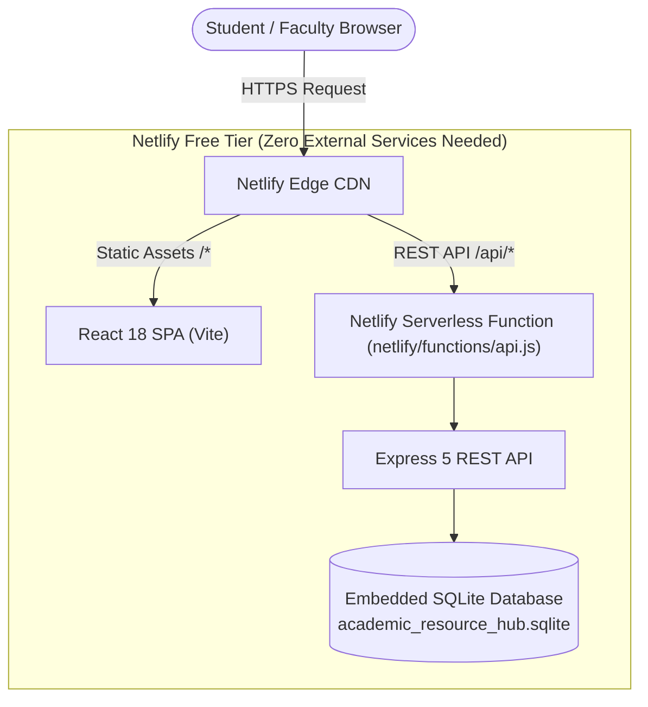

# Netlify Free Full-Stack Hosting Guide • Academic Resource Hub
## React 18 Frontend + Serverless Express Backend + Embedded SQLite Database

This project is fully equipped to run both the **frontend** and the **backend with SQLite database** directly on **Netlify's Free Plan**.

---

## Architecture Overview



---

## Key Benefits of SQLite on Netlify

1. **Zero External Database Configuration**: You don't need to create or pay for a MySQL cloud instance (TiDB, PlanetScale, Aiven, or Railway). SQLite runs right inside the backend.
2. **Automatic Schema & Seeding**: On first run, SQLite automatically provisions tables, academic departments, subjects, resource types, and default demo accounts.
3. **100% Free**: Operates within Netlify's free bandwidth (100GB/mo) and free serverless execution quotas (125k requests/mo).
4. **Instant Cold Start**: Zero database connection overhead or pooling latency.

---

## 🚀 How to Deploy on Netlify

### Step 1: Push Changes to GitHub
```bash
git add .
git commit -m "Configure full-stack Netlify serverless deployment with SQLite"
git push origin master
```

### Step 2: Connect Repository on Netlify
1. Log in to [https://app.netlify.com](https://app.netlify.com).
2. Click **Add new site** $\rightarrow$ **Import an existing project**.
3. Select **GitHub** and choose your `academic-resource-hub` repository.
4. Netlify will automatically detect [`netlify.toml`](file:///c:/Users/User/Desktop/academic-resource-hub/netlify.toml):
   - **Build command**: `npm run build`
   - **Publish directory**: `frontend/dist`
   - **Functions directory**: `netlify/functions`
5. Click **Deploy Site**.

Your site will be live at `https://<site-name>.netlify.app` within ~60 seconds!

---

## 🔑 Default Test Accounts (Pre-Seeded in SQLite)

| Role | Email | Password | Access Capabilities |
| :--- | :--- | :--- | :--- |
| **Faculty / Staff** | `staff@college.edu` | `Password@123` | Resource approval, audit reviews, analytics |
| **Student** | `student@college.edu` | `Password@123` | Browse & upload materials, AI tools, study requests, bookmarks |
| **Administrator** | `admin@college.edu` | `Password@123` | Full system administration and taxonomy controls |

---

## 📂 Configuration Files Summary

| File | Purpose |
| :--- | :--- |
| [`netlify.toml`](file:///c:/Users/User/Desktop/academic-resource-hub/netlify.toml) | Declares build command, `frontend/dist` static directory, `netlify/functions` serverless directory, and `/api/*` rewrite |
| [`netlify/functions/api.js`](file:///c:/Users/User/Desktop/academic-resource-hub/netlify/functions/api.js) | Serverless wrapper (`serverless-http`) that invokes Express on Lambda |
| [`backend/config/sqliteDb.js`](file:///c:/Users/User/Desktop/academic-resource-hub/backend/config/sqliteDb.js) | High-performance embedded SQLite driver with auto-provisioning and MySQL-compatible query interface |
| [`frontend/public/_redirects`](file:///c:/Users/User/Desktop/academic-resource-hub/frontend/public/_redirects) | Fallback SPA and serverless API redirects bundled into Vite build |
