# Academic Resource Hub - UI Screenshots Gallery

High-resolution captures of the live application across the student and faculty/staff portals.

---

## Student Portal Screens

### 1. Student Dashboard
Personalized landing page with AI-powered study material recommendations matching department & semester, quick metric counts, and revision bookmarks.
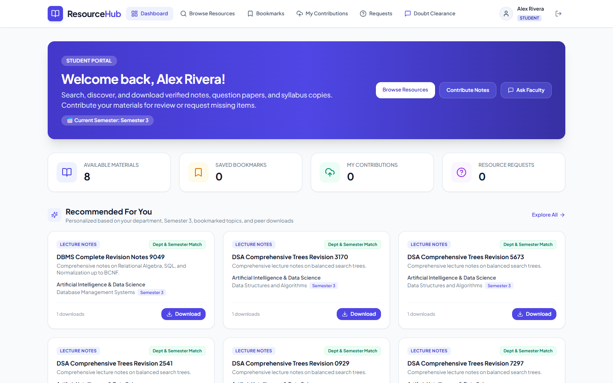

### 2. Academic Resources Search & Filter
Parametric search across departments, subjects, document categories, and semesters with instant download and bookmark actions.
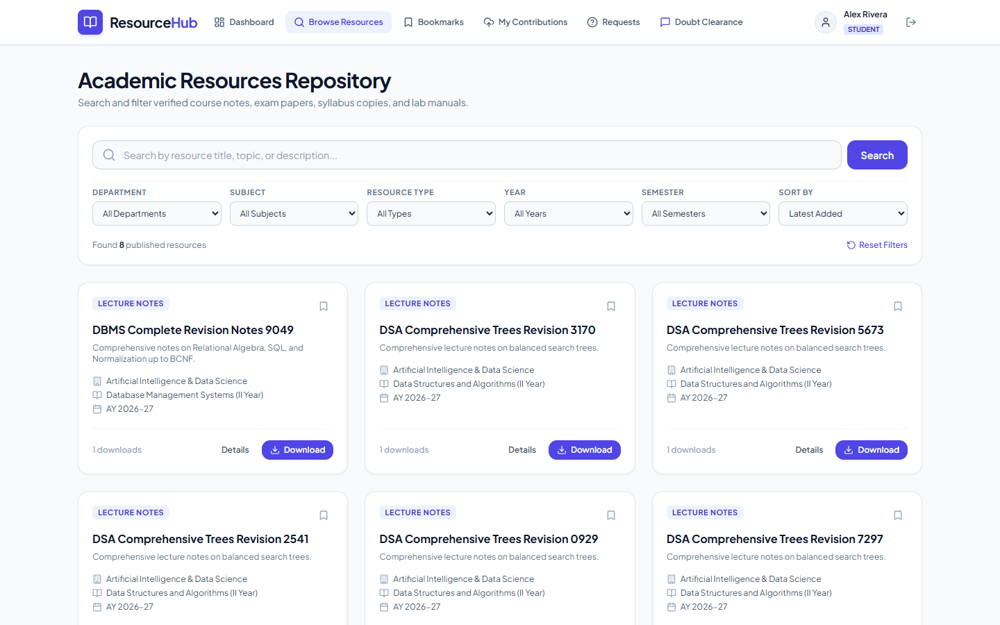

### 3. Student Contributions & Upload
Upload interface allowing students to contribute study materials with automated `PENDING` review workflow status assignment.
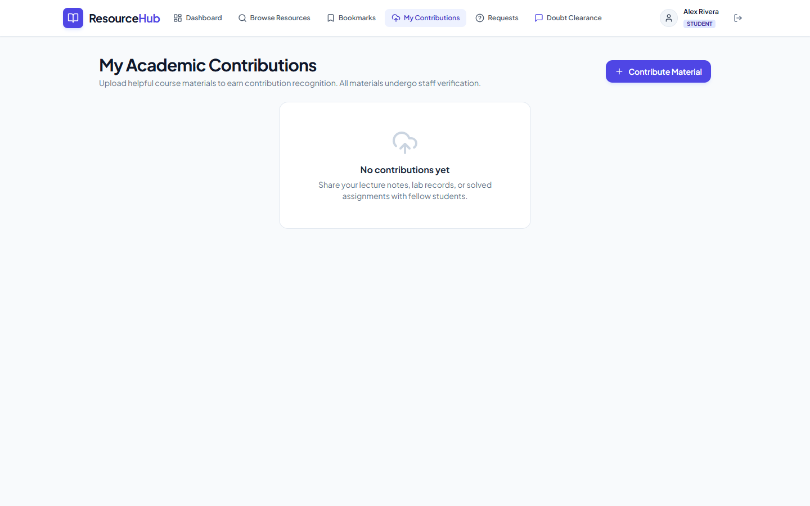

### 4. Saved Bookmarks
Personal revision hub containing saved materials for quick access before tests and semester exams.
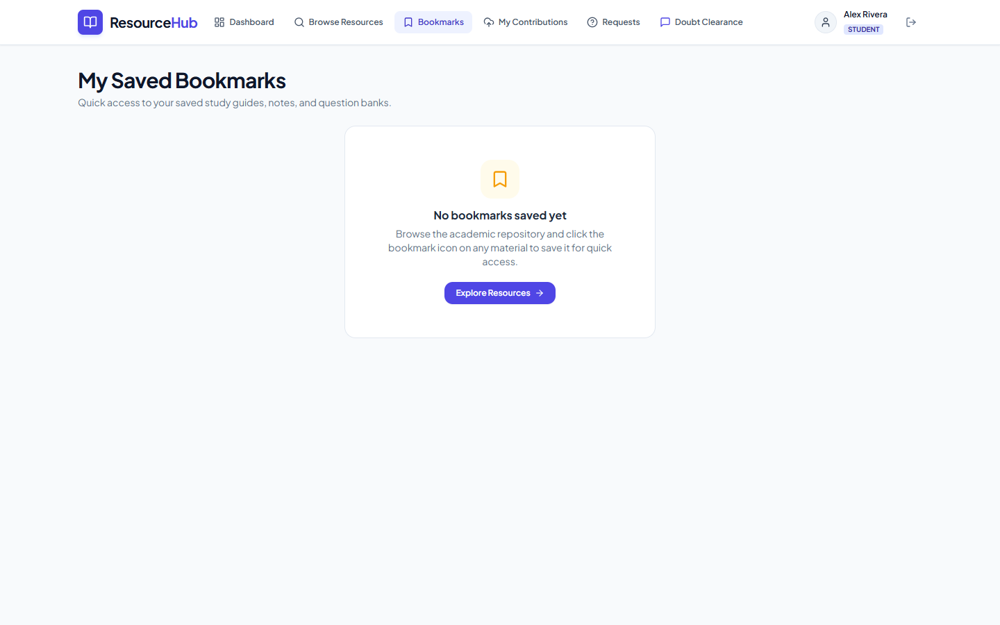

### 5. Student Requests
Study material request submission and tracking board for missing question papers and notes.
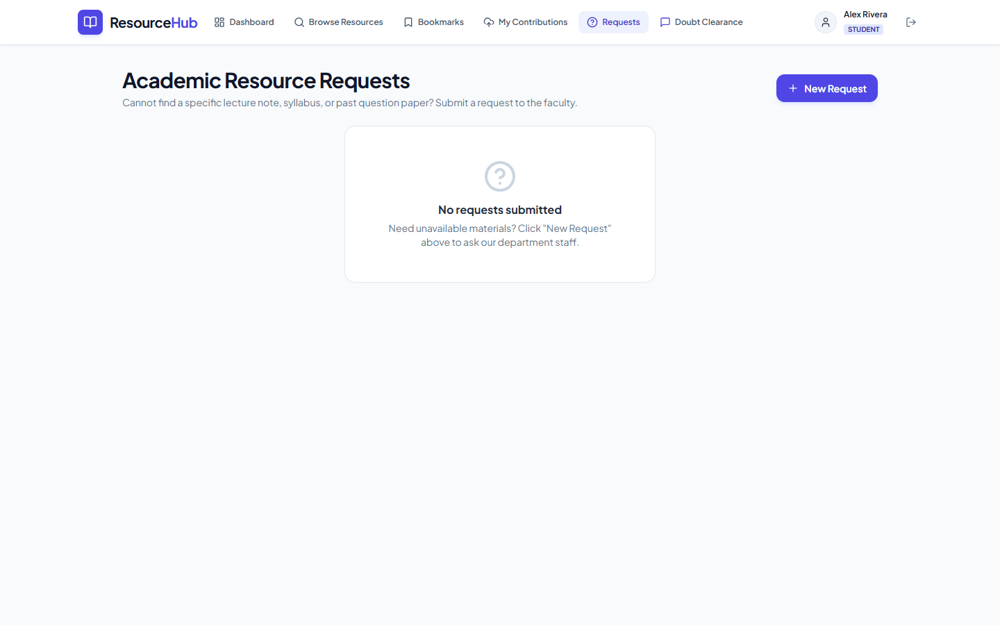

### 6. Real-Time Doubt Clearance Chat
Live WebSocket-powered doubt clearance chat with faculty members including typing indicators and message history.
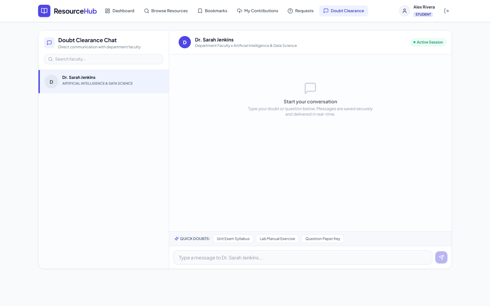

---

## Faculty & Staff Console Screens

### 7. Staff Dashboard
Faculty console providing high-level oversight of pending student submissions, active requests, total materials, and download metrics.
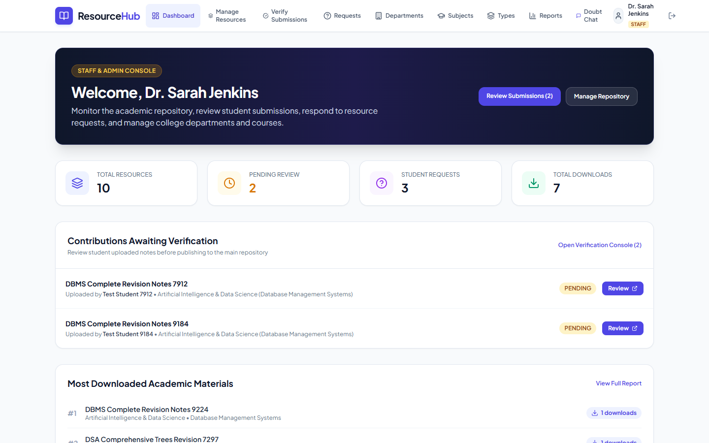

### 8. Verify Student Contributions
Staff review queue for inspecting uploaded notes, verifying syllabus coverage, and publishing or rejecting submissions with remarks.
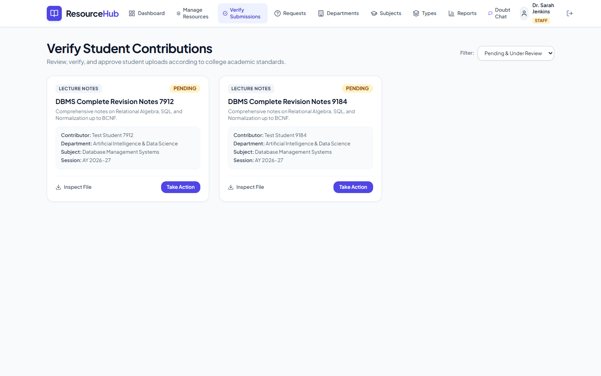

### 9. Manage Academic Repository
Comprehensive tabular management view with edit, download, and archive capabilities.
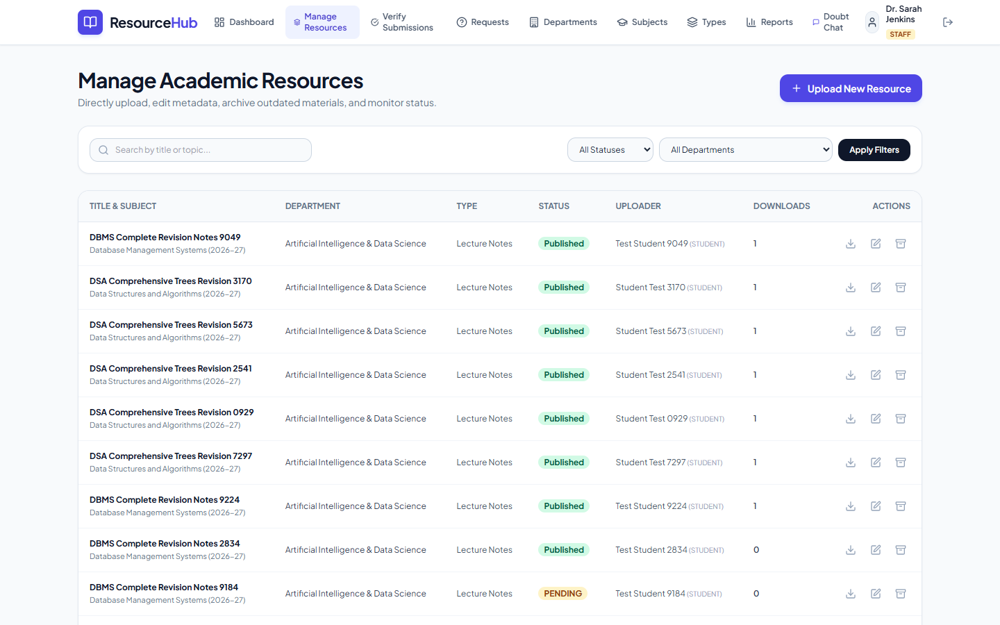

### 10. Student Requests Board
Board for reviewing and fulfilling student academic requests.
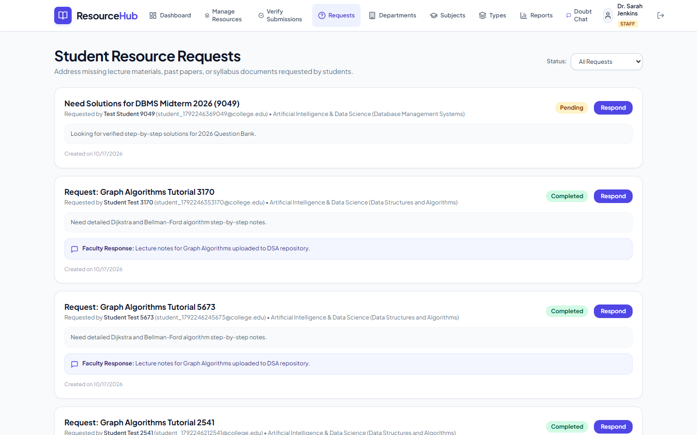

### 11. Usage Analytics & Reports
System-wide metrics tracking most popular materials, department activity breakdown, and recent download audit logs.
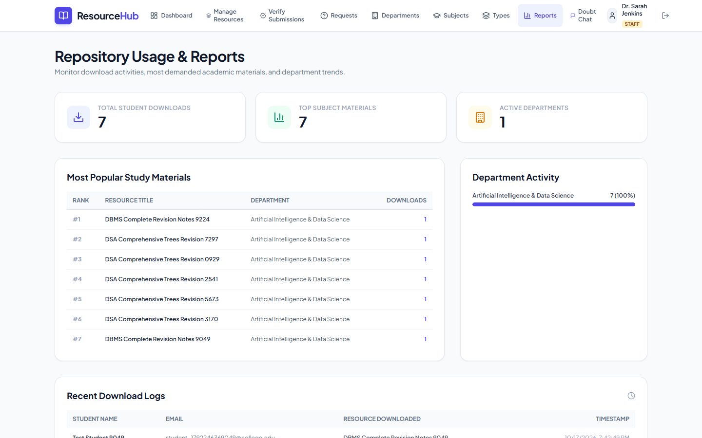

### 12. Subjects & Curriculum Management
Taxonomy administration view for managing academic departments and course subjects.
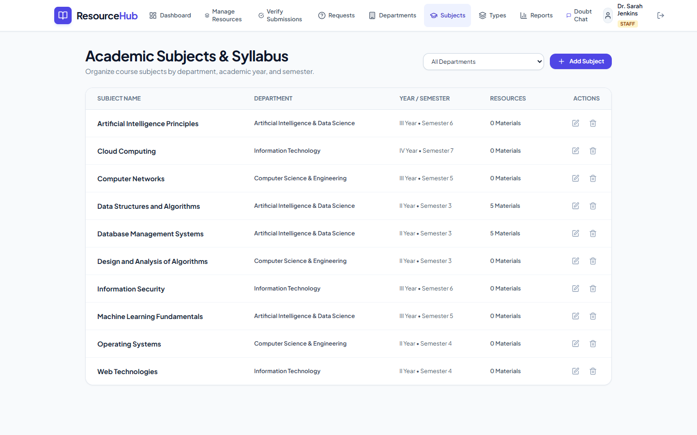

---

## AI Academic Intelligence & Doubts Resolution Screens

### 13. All-in-One Help Center & User Guide
Interactive platform guide for students and faculty explaining the complete upload, verification, search, and doubt clearance flows.
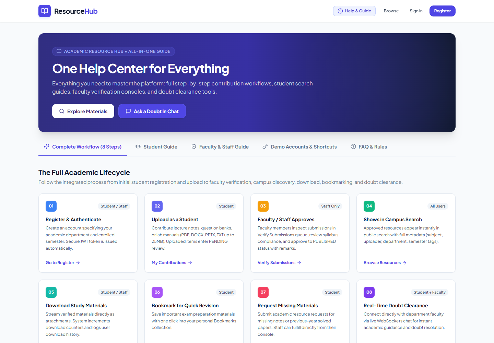

### 14. Automated Doubt Clarity Replier
Instant automated pedagogical breakdown and verified note recommendations delivered automatically upon student questions.
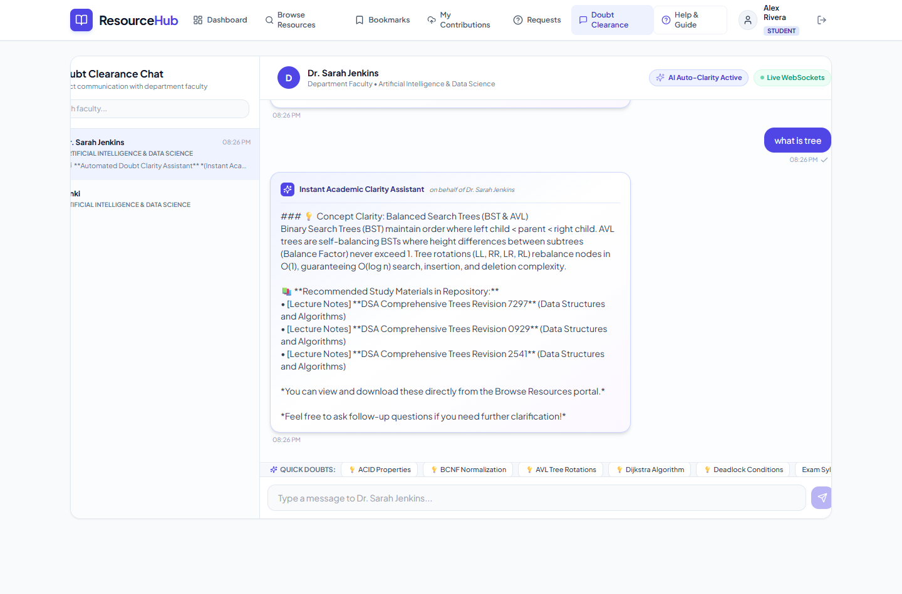

### 15. egspec.com AI Academic Tools Suite (`/ai-tools`)
Dedicated full-page AI workspace featuring:
1. Concept & Doubt Clarifier (Simple, 13-Mark Model, and Deep Technical)
2. SQL & Code Debugger with complexity analysis
3. University Exam Question & Scoring Rubric Generator
4. High-Yield Revision Cheat-Sheet Builder
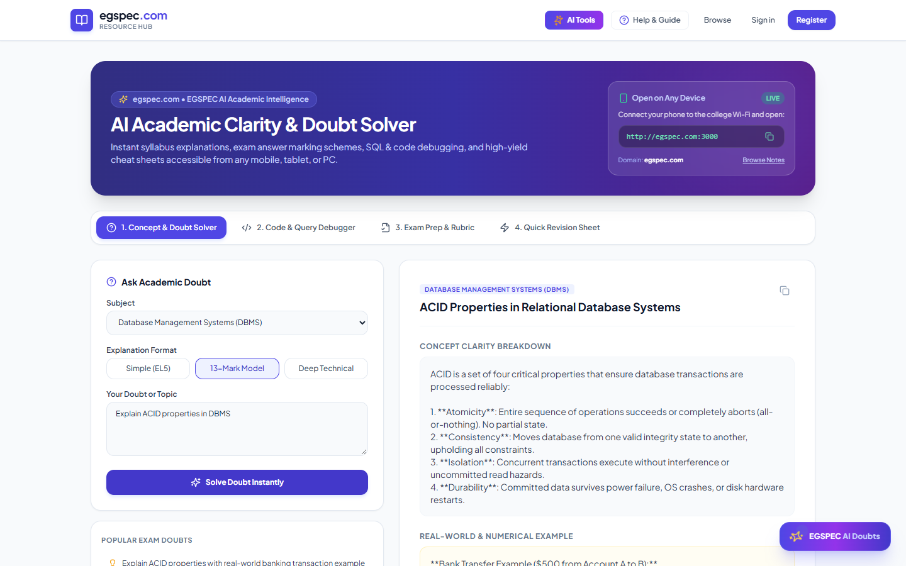

### 16. Global Floating AI Doubt Assistant Drawer
Persistent floating drawer accessible across every page and on any device to get instant syllabus explanations on the go.
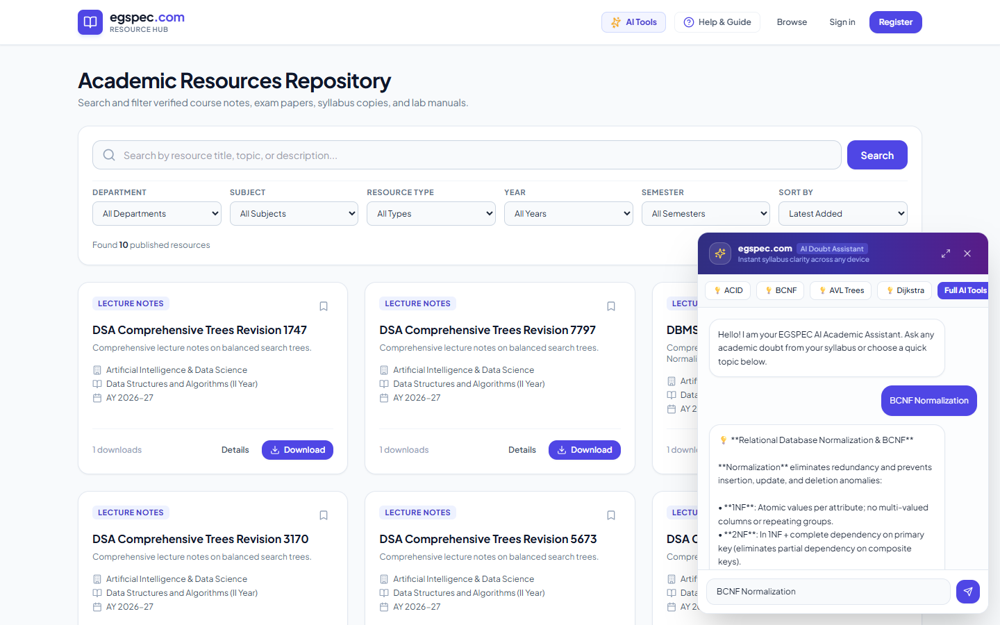

